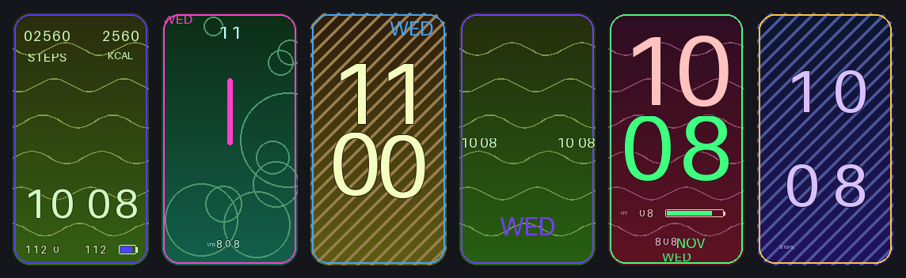
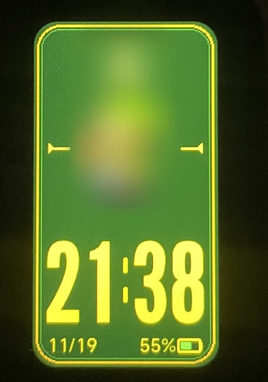
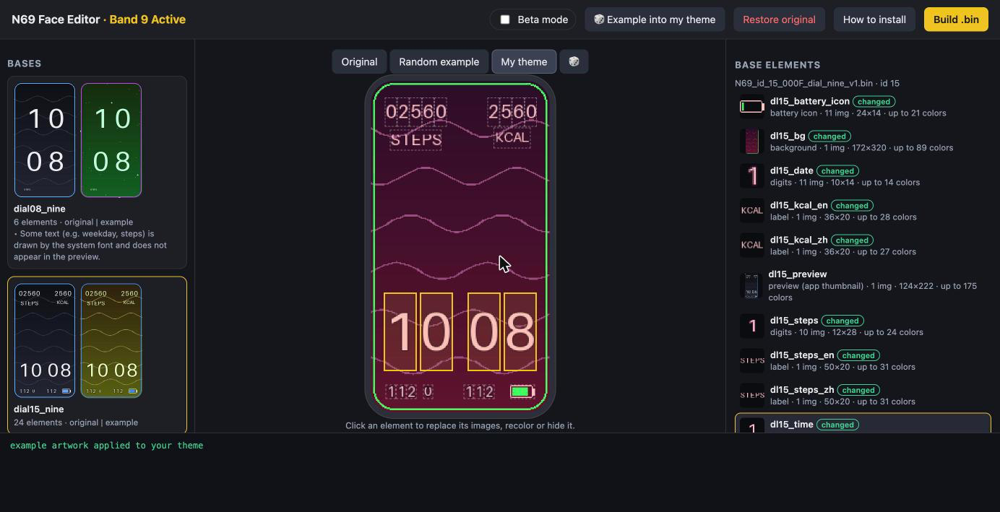

# N69 Face Editor

**A visual watch face editor for the Xiaomi Smart Band 9 Active** (model `miwear.watch.n69gl`, 172×320 screen) —
a band that is *not* supported by Mi Create, AmazFaces, EasyFace or any other face maker.



> ⚠️ **Unofficial project, not affiliated with Xiaomi. Use at your own risk.**
> In our tests the worst case was a face **failing to install** — the band never froze with our custom faces.
> Tested with an iPhone; see [Android](#android) below.

> 🤖 **This project was entirely vibe coded.** The reverse engineering, the code and the docs were produced
> in a conversation with an AI assistant (Claude), guided and tested on a real band by the author. It works
> for us, but the code has not been reviewed line by line by an experienced developer — expect rough edges,
> read before you trust it, and feel free to open issues or pull requests.

<p align="center">
  
  <br><sub>A real custom face (green &amp; gold theme on the <code>dial15_nine</code> base) running on a Band 9 Active.
  The character artwork is blurred because it belongs to its owner.</sub>
</p>

---

## Contents

1. [How it works](#how-it-works)
2. [Requirements](#requirements)
3. [Installation](#installation)
4. [Quick start](#quick-start)
5. [Using the editor](#using-the-editor)
6. [Installing your face on the band](#installing-your-face-on-the-band)
7. [The replacement script (mitmproxy addon)](#the-replacement-script-mitmproxy-addon)
8. [Getting more bases](#getting-more-bases)
9. [Command line reference](#command-line-reference)
10. [Technical notes (file format)](#technical-notes-file-format)
11. [Troubleshooting](#troubleshooting)
12. [Limitations](#limitations)
13. [Legal](#legal)

---

## How it works

Band 9 Active faces are very different from Band 8/9/10 faces. Each face is a **compiled ARM program**
(`app.so`, written with the LVGL graphics library) plus a module that holds its images (`resource.so`).
You cannot write a face from scratch without compiling code, but you can **start from an existing face
(a "base")** and change it:

| Mode | What you can do | Risk |
|---|---|---|
| **Normal** | Replace any image (background, digits, icons, labels…), recolor, hide elements | Low — the base's code is untouched |
| **Beta** | Move elements, resize them, turn an element into a **sticker** (a free image of any size, using space from images the base never draws) | Higher — patches numbers (position/size) inside the base's code; less tested |

The layout (which elements exist: time, date, battery, steps…) comes from the base you pick. If you want
date and battery, pick a base that already has them. The editor shows every base with its own artwork and
with **random example designs**, so you can see the layout before choosing.

Mi Fitness only installs faces from Xiaomi's store, so installation uses a small **proxy on your computer**
that hands your file to the phone instead of a store face while it is being downloaded
([details](#the-replacement-script-mitmproxy-addon)).

## Requirements

- **Python 3.9 or newer** (Windows, macOS or Linux)
- **Pillow** (installed below)
- **mitmproxy** — only for installing faces on the band and capturing new bases
- The **Mi Fitness** app with your Band 9 Active paired, and the phone on the same Wi-Fi as the computer

## Installation

```bash
git clone https://github.com/bernardmotoni/n69face-editor.git
cd n69face-editor

python3 -m venv .venv
source .venv/bin/activate          # Windows: .venv\Scripts\activate

pip install -r requirements.txt    # Pillow
pip install mitmproxy              # needed to install faces on the band
```

> macOS users can also install mitmproxy with `brew install mitmproxy`.

## Quick start

```bash
python -m n69face                  # opens the editor at http://127.0.0.1:8765
```

1. Pick a base on the left.
2. Click an element on the band screen (or in the list on the right) and replace its images.
3. Click **Build .bin** — your face is saved to `projects/<base>/<base>_custom.bin`.
4. Install it: `python -m n69face install projects/<base>/<base>_custom.bin`
   and follow [these steps](#installing-your-face-on-the-band).

## Using the editor



**Left — bases.** Each card shows the base (left) and a random example design (right). Notes such as
"the background exists but is not drawn" or "analog face" are shown under the card.

**Center — the band screen.** Tabs:
- **Original** — the base as it is.
- **Random example** — random artwork to visualize the layout (🎲 for another one).
- **My theme** — your work. Dashed boxes mark each element; click one to select it.

**Right — elements of the base.** Each element (group of images) shows its kind, number of images, size
and color limit. Select one to:

- **Replace an image** — click its thumbnail and pick a PNG. Other sizes are fitted automatically
  (*pixel art* keeps it sharp with integer scaling, *smooth* resamples).
- **Upload several (in order)** — replace all images of the element at once, sorted by file name
  (e.g. `0.png` … `9.png` for digits; date digits often have an 11th image for the separator).
- **Recolor** — paints the element in a color, keeping the shading.
- **Hide / Show** — makes the element transparent (e.g. remove steps and calories).
- **Undo** — restores that element.

Tips:
- Images use a color palette (shown as "up to N colors"); the editor reduces colors automatically.
- Elements marked **not drawn** are never shown by that base's code — changing them has no effect.
- The thumbnail shown in the Mi Fitness app is generated automatically from your design
  (unless you upload your own image for the `preview` element).
- Your work is saved automatically in `projects/<base>/`.
- **🎲 Example into my theme** fills your theme with random art — a quick way to start.
- **Restore original** discards everything for that base.

### Beta mode

Turn on **Beta mode** in the top bar (you will be asked to confirm). Then:

- **Move** — drag an element on the screen, use the arrow keys (Shift = 5 px) or type X/Y.
  Only elements whose position is a constant in the code can be moved; others show
  "position computed by the code".
- **Resize** — set W/H for an element (applies to all its images). Bigger images borrow space from
  images the base does not use; the panel shows the largest free block.
- **Sticker** — replace an element with any image (any size). Great for turning an unwanted element
  (e.g. the steps label) into a static drawing. If it does not fit, the editor tells you how much space
  is available.

Limits you may hit (the editor explains them): many positions/sizes are stored in 8-bit instructions
(max 255), and some values above 255 must be even. Turning beta mode off discards beta changes.

## Installing your face on the band

The proxy replaces **the next face you download in Mi Fitness** with your file.

1. **Build** your face in the editor.
2. **Start the install proxy** on the computer:
   ```bash
   python -m n69face install projects/<base>/<base>_custom.bin
   ```
   It prints the computer's IP address and the port (8080).
3. **Point the phone to the proxy** (same Wi-Fi network):
   - iPhone: *Settings → Wi-Fi → (i) next to your network → Configure Proxy → Manual* —
     Server: the computer's IP, Port: `8080`.
   - If the computer asks whether `mitmdump` may accept connections, allow it.
4. **Install the proxy certificate** (needed because the download uses HTTPS):
   - Open **http://mitm.it** in Safari on the phone and tap the Apple icon.
   - *Settings → Profile Downloaded → Install*.
   - *Settings → General → About → Certificate Trust Settings* → turn **mitmproxy** on.
   - Check that a website opens normally in Safari.
5. **In Mi Fitness, install a free store face you have never installed before.**
   The terminal shows `*** replaced …` and the band receives your design.
   (Re-installing a face that is already on the band may show cached images.)
6. **Clean up — important:**
   - Turn the Wi-Fi proxy **Off** on the phone.
   - Remove the certificate: *Settings → General → VPN & Device Management → mitmproxy → Remove Profile*.
   - Press `Ctrl+C` in the terminal.

Your face shows up in Mi Fitness under the name of the store face it replaced. If the app later updates or
reinstalls that store face, the original comes back — just repeat the steps.

### Android

The same proxy works on Android in principle, but since Android 7 apps ignore user-installed certificates
unless they opt in, so Mi Fitness will probably refuse the proxy's certificate on a non-rooted phone.
If you get it working on Android, please open an issue or a pull request with the steps.

## The replacement script (mitmproxy addon)

Installation is done by [`n69face/addons/n69_proxy.py`](n69face/addons/n69_proxy.py), a small
[mitmproxy](https://mitmproxy.org) addon. `python -m n69face install` / `capture` just start `mitmdump`
with it. You can also run it yourself:

```bash
# deliver my_face.bin instead of the next face downloaded by Mi Fitness
mitmdump --listen-host 0.0.0.0 --listen-port 8080 -s n69face/addons/n69_proxy.py \
         --set n69_file=my_face.bin --set block_global=false

# save every official face downloaded by Mi Fitness into bases/
mitmdump --listen-host 0.0.0.0 --listen-port 8080 -s n69face/addons/n69_proxy.py \
         --set n69_capture_dir=bases --set block_global=false
```

What it does, step by step:

1. Looks at every HTTP response from the phone. Anything that is not a `.bin` file starting with the
   N69 magic bytes `CD AB 34 12` passes through **unchanged** (the rest of your traffic is not modified).
2. **Capture mode** (`n69_capture_dir`): saves the face file, named after the face, and lets it continue
   to the phone untouched.
3. **Swap mode** (`n69_file`):
   - skips official *photo* faces (they contain no code and are generated by the app);
   - loads your custom face and **copies the requested face's name (offset `0x0C..0x3C`) and face ID
     (offset `0x74`) into it**, so the band files it as that store face and does not reuse a cached copy
     of another face;
   - returns your file to the phone instead of the original.

The core of the swap is just:

```python
body = bytearray(open(custom_file, "rb").read())
body[0x0C:0x3C] = original[0x0C:0x3C]      # face name
body[0x74:0x78] = original[0x74:0x78]      # face ID
flow.response.content = bytes(body)
```

## Getting more bases

The repository includes **neutral bases** in [`bases/`](bases/README.md): official layouts whose images were
**all replaced with generated artwork**. To use other official layouts, capture them:

```bash
python -m n69face capture          # saves faces downloaded by Mi Fitness into bases/
```

Set up the phone exactly as in [Installing your face](#installing-your-face-on-the-band) (proxy +
certificate), then install the store faces you want in Mi Fitness. Good bases have the elements you
need (date, battery, …) and a background that is actually drawn — the editor tells you both.

To share bases without the original artwork, neutralize them first:

```bash
python tools/make_neutral_bases.py bases/*.bin --out neutral/
```

## Command line reference

```bash
python -m n69face                                   # visual editor (options: --port, --bases, --projects, --no-browser)
python -m n69face inspect bases/dial15_nine.bin     # elements, kinds, sizes, colors, positions
python -m n69face extract bases/dial15_nine.bin out/   # export every image of a base as PNG
python -m n69face capture [--out bases]             # capture proxy
python -m n69face install my_face.bin               # install proxy
python -m n69face import-amazfit face.bin out/      # extract artwork from Band 8/9/10 faces (5AA5 format)
python tools/make_neutral_bases.py files... --out dir/   # replace all images with generated art
```

## Technical notes (file format)

Reverse engineered from official faces downloaded by Mi Fitness:

| Item | Format |
|---|---|
| Container | magic `CD AB 34 12`; face name at `0x0C..0x3C`; author and build date follow; face ID at `0x74`; a `ver-YYYY/MM/DD` trailer; no signature or checksum was found |
| Modules | two ELF32 ARM (Thumb-2) shared objects: `app.so` (LVGL code, firmware APIs `AMS_*`, `DL_*`, `UX_*`) and `resource.so` (images + `lv_img_dsc_t` descriptors) |
| Images | LVGL `cf=25` (user-encoded): `u32 N` + `N` palette entries in **B,G,R,A** order (index 0 = transparent) + one index byte per pixel. Some backgrounds use `cf=5`: RGB565 little-endian + alpha (3 bytes/pixel) |
| Image size | descriptor header: `cf | w << 10 | h << 21`, then `data_size`, then a pointer filled by an `R_ARM_ABS32` relocation to the `img_*_map` symbol |
| Layout | each object is created with `lv_obj_set_pos(obj, x, y)` and `lv_obj_set_size(obj, w, h)`; `x/y/w/h` are `MOVS` (8-bit), `MOVW` (16-bit) or `MOV.W` (rotated immediate) instructions right before the call |
| Drawn or not | an image is drawn only if `app.so` references it (some bases ship a background that is never used) |
| Beta stickers | the descriptor's relocation is re-pointed to the pixel data of an unused image, and the object's size instructions are patched |

The Band 8/9/10 importer handles the `5A A5 34 12` format: RLE blocks starting with `E0 21 A5 5A`,
header `pixels × bpp × 2 + mode` (mode 2 = RGB565, 3 = RGB565+alpha, 4 = BGRA), tokens of
`count & 0x7F` + one pixel.

## Troubleshooting

| Problem | Fix |
|---|---|
| Phone has no internet after testing | The Wi-Fi proxy is still on — turn it off (and stop `mitmdump` only afterwards) |
| Every HTTPS site fails while the proxy is on | The certificate is installed but not trusted — enable it in *Certificate Trust Settings* |
| The terminal never shows `replaced` | You installed a face that was already downloaded/cached — pick one you never installed; check the phone really uses the proxy |
| The band shows a mix of old and new images | The band reused cached images — install your file in place of a face you never installed |
| The band shows the face but not the background | That base does not draw its background (the editor marks it **not drawn**) — pick another base, or use a beta sticker |
| Colors look wrong | The band uses BGRA order; the editor already handles it — report it if you see swapped red/blue |
| The face fails to install / Mi Fitness shows an error | The file was rejected — undo your last beta change (or try normal mode only) and install again; please report the base and what you changed |

## Limitations

- Only the **Band 9 Active** has been tested (the Band 8 Active looks similar but is untested).
- You cannot add new kinds of elements (e.g. battery on a base without battery). Stickers reuse an
  existing element as a static image.
- Some positions are computed by the face's code; they appear as "estimated" in the preview and cannot be moved.
- Text drawn with the system font (e.g. the weekday on some bases) does not appear in the preview.
- Official photo faces (`custom_dial`) contain no code and cannot be edited here — use the Mi Fitness app for those.

## Legal

The code in this repository is released under the [MIT license](LICENSE). The bundled bases contain no Xiaomi
artwork (all images are generated), but their layout code comes from official Xiaomi faces and is included only
for interoperability. Do not publish faces that contain artwork you do not have the rights to
(characters, logos, other people's designs). "Xiaomi" and "Mi Fitness" are trademarks of their owners.
