# Included bases

Starting points for the editor. Each one comes from an official Xiaomi Smart Band 9 Active watch face,
but **every image was replaced with generated artwork** by `tools/make_neutral_bases.py`
(background, digits, icons, labels, thumbnails and even images the face never draws).
Only the layout code (`app.so`) is kept, because the face does not work without it.

Want other layouts? Capture official faces with `python -m n69face capture` and either edit them
directly or neutralize them with `python tools/make_neutral_bases.py <files> --out bases/`.

| Base | Random example | File | Elements drawn | Background | Notes |
|---|---|---|---|---|---|
| 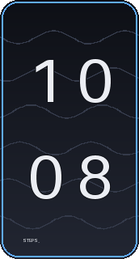 |  | `dial08_nine.bin` | background, digits, icon | yes, up to 80 colors | Some text (e.g. weekday, steps) is drawn by the system font and does not appear in the preview. |
| 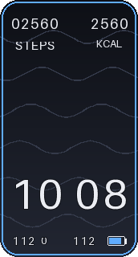 | 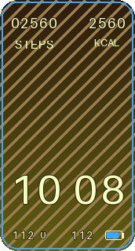 | `dial15_nine.bin` | background, battery icon, digits, label | yes, up to 89 colors |  |
| 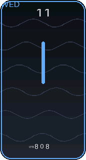 | 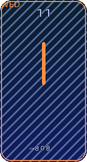 | `dial24_nineteen.bin` | background, digits, hand (analog), icon, weekday | yes, true color | Analog face: the hands are rotated by the code. |
| 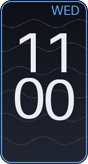 | 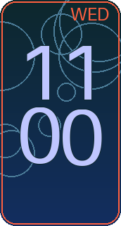 | `dial38_nine.bin` | background, digits, icon, weekday | yes, up to 70 colors | Some text (e.g. weekday, steps) is drawn by the system font and does not appear in the preview. |
| 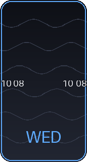 | 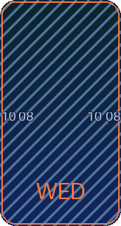 | `dial53_fifty-two.bin` | background, digits, weekday | yes, up to 255 colors |  |
| 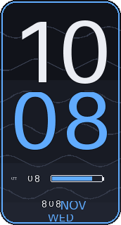 | 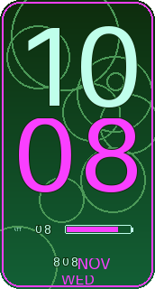 | `dial65_seventy-six.bin` | battery icon, digits, icon, month, weekday | exists but **not drawn** | The background (dl65_bg) exists but this face's code does NOT draw it. |

Run `python -m n69face inspect bases/<file>.bin` for the full list of elements, sizes and positions.
